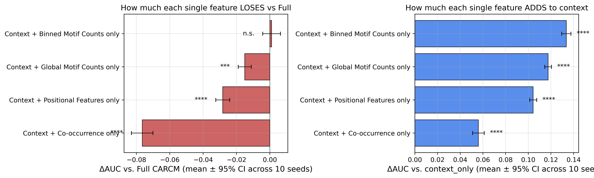
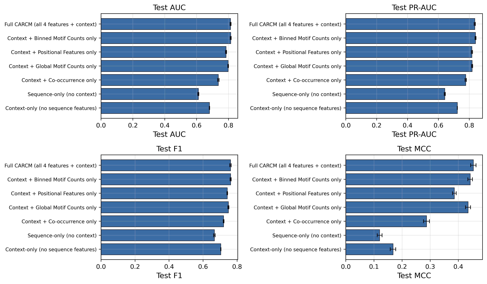

# LOI Feature Ablation — Report

## Executive summary

Four leave-one-IN configurations: each retains a single sequence-side feature block (Binned Motif Counts, Positional Features, Global Motif Counts, or Co-occurrence) and the full (Variety, Tissue, Stage) context branch. References (Full CARCM, sequence_only, context_only) are reused from the parent context-ablation study without retraining. Each configuration trained with 10 seeds, 150 epochs, patience 25 — identical to the v7c regime. Metrics are mean [95% CI] across seeds; ensemble AUCs come from the v7b 5-method best-of selection. Test set: n = 4451.

## Table — Single-feature + context (LOI)

| # | Configuration | Ensemble AUC | AUC mean [95% CI] | ΔAUC vs Full | ΔAUC vs context_only | DeLong p vs Full | DeLong p vs context_only |
|---|---|---|---|---|---|---|---|
| 1 | Full CARCM (all 4 features + context) | 0.8531 | 0.8129 [0.8096, 0.8162] | +0.0000 [+0.0000, +0.0000] | +0.1326 [+0.1297, +0.1354] | n/a n.s. | <1e-300 **** |
| 17 | Context + Binned Motif Counts only | 0.8484 | 0.8139 [0.8105, 0.8172] | +0.0010 [-0.0043, +0.0063] | +0.1336 [+0.1295, +0.1376] | 0.1051 n.s. | <1e-300 **** |
| 18 | Context + Positional Features only | 0.8135 | 0.7846 [0.7812, 0.7881] | -0.0282 [-0.0324, -0.0240] | +0.1043 [+0.1012, +0.1074] | <1e-300 **** | <1e-300 **** |
| 19 | Context + Global Motif Counts only | 0.8389 | 0.7978 [0.7955, 0.8001] | -0.0151 [-0.0190, -0.0111] | +0.1175 [+0.1145, +0.1205] | 0.0007 *** | <1e-300 **** |
| 20 | Context + Co-occurrence only | 0.7569 | 0.7364 [0.7318, 0.7409] | -0.0765 [-0.0829, -0.0701] | +0.0561 [+0.0509, +0.0612] | <1e-300 **** | <1e-300 **** |
| 2 | Sequence-only (no context) | 0.6211 | 0.6107 [0.6076, 0.6139] | -0.2021 [-0.2077, -0.1966] | -0.0696 [-0.0734, -0.0657] | <1e-300 **** | 2.01e-07 **** |
| 7 | Context-only (no sequence features) | 0.6811 | 0.6803 [0.6790, 0.6817] | -0.1326 [-0.1354, -0.1297] | +0.0000 [+0.0000, +0.0000] | <1e-300 **** | n/a n.s. |

Significance markers: **** p<1e-4, *** p<1e-3, ** p<1e-2, * p<5e-2, n.s. otherwise.

## Conclusions

- Full CARCM (all 4 features + ctx) AUC = 0.8531; context_only (no sequence) = 0.6811; sequence_only (no context) = 0.6211.
- **Context + Binned Motif Counts only**: ensemble AUC = 0.8484. ΔAUC vs Full = +0.0010, ΔAUC vs context_only = +0.1336. This single feature alone, when paired with full context, recovers 97.3% of Full's gain over context_only.
- **Context + Positional Features only**: ensemble AUC = 0.8135. ΔAUC vs Full = -0.0282, ΔAUC vs context_only = +0.1043. This single feature alone, when paired with full context, recovers 77.0% of Full's gain over context_only.
- **Context + Global Motif Counts only**: ensemble AUC = 0.8389. ΔAUC vs Full = -0.0151, ΔAUC vs context_only = +0.1175. This single feature alone, when paired with full context, recovers 91.8% of Full's gain over context_only.
- **Context + Co-occurrence only**: ensemble AUC = 0.7569. ΔAUC vs Full = -0.0765, ΔAUC vs context_only = +0.0561. This single feature alone, when paired with full context, recovers 44.1% of Full's gain over context_only.

## Figures

*Figure 1. Two-panel comparison. Left: ΔAUC vs Full CARCM (negative — how much each single feature loses vs the all-features baseline). Right: ΔAUC vs context_only (positive — how much each single feature adds on top of pure context features). Bars are paired-seed mean ± 95% CI; markers are DeLong p vs the corresponding reference.*

*Figure 2. Per-configuration mean ± 95% CI for AUC, PR-AUC, F1 and MCC, covering the 4 single-feature configurations and the 3 reference rows.*
