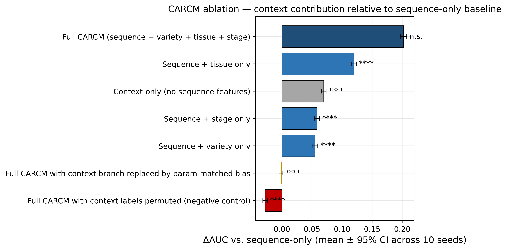
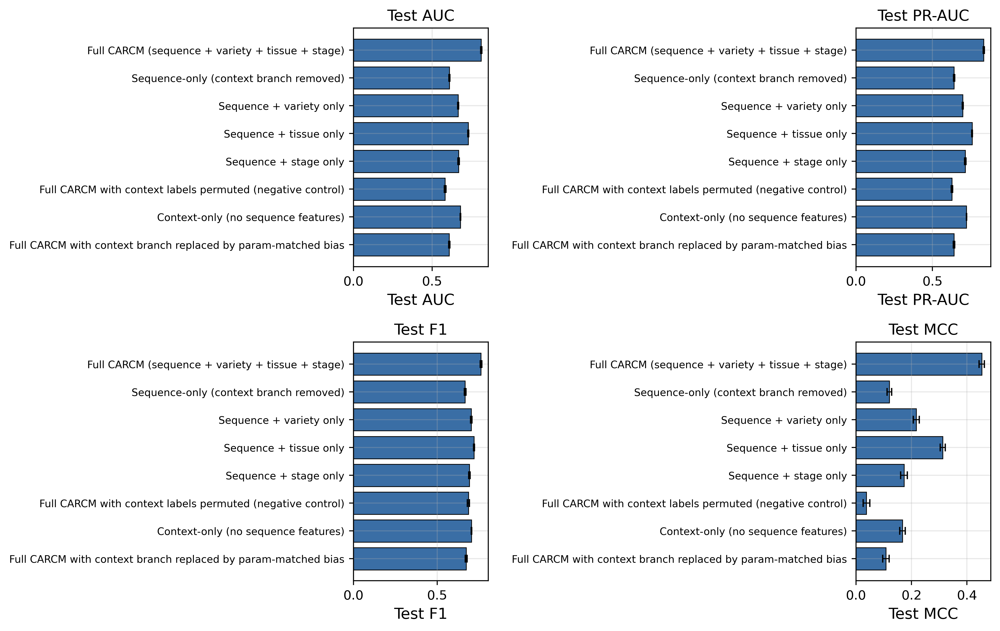
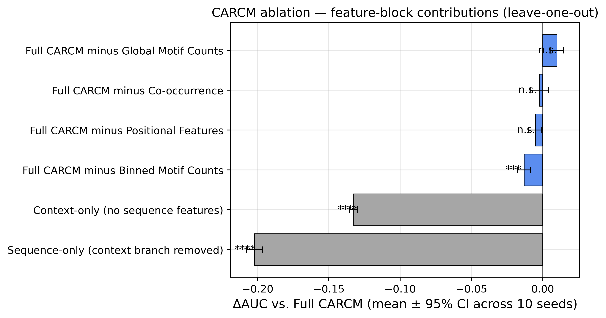
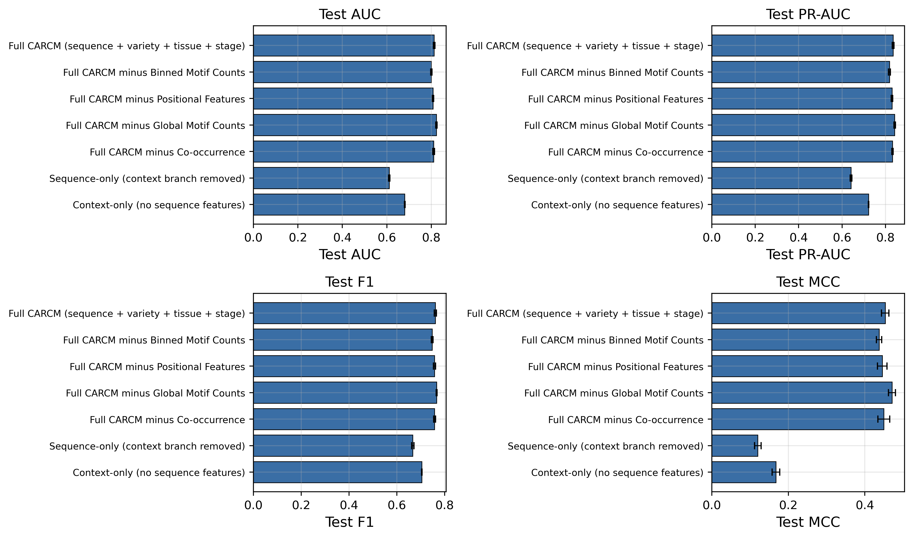
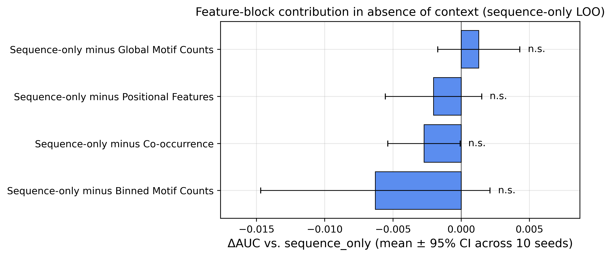
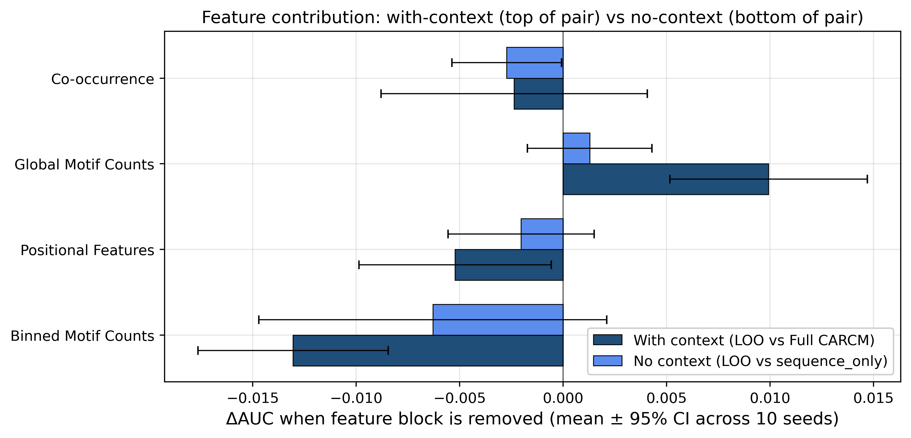

# CARCM Ablation Study

## Executive summary

Two complementary ablations on the same architecture, training regime, and random-split test set (n = 4451). The **context ablation** (8 configs) removes or perturbs the (Variety, Tissue, Stage) context branch to isolate its contribution. The **feature-block ablation** (4 configs) leaves the context branch intact and removes one of the four sequence-side feature blocks (Binned Motif Counts, Positional Features, Global Motif Counts, Co-occurrence) at a time. Each configuration was trained with 10 seeds; metrics are reported as mean [95% CI] across seeds. DeLong p-values are computed against the Full CARCM model on the simple-mean ensemble of seeds.

## Table 1 — Context ablation

| # | Configuration | AUC mean [95% CI] | PR-AUC mean [95% CI] | F1 mean [95% CI] | MCC mean [95% CI] | ΔAUC vs Seq-only | DeLong p vs Full |
|---|---|---|---|---|---|---|---|
| 1 | Full CARCM (sequence + variety + tissue + stage) | 0.8129 [0.8096, 0.8162] | 0.8354 [0.8313, 0.8395] | 0.7610 [0.7564, 0.7656] | 0.4533 [0.4437, 0.4629] | +0.2021 [+0.1966, +0.2077] | n/a n.s. |
| 2 | Sequence-only (context branch removed) | 0.6107 [0.6076, 0.6139] | 0.6410 [0.6371, 0.6450] | 0.6665 [0.6617, 0.6713] | 0.1202 [0.1117, 0.1286] | +0.0000 [+0.0000, +0.0000] | <1e-300 **** |
| 3 | Sequence + variety only | 0.6657 [0.6629, 0.6685] | 0.6982 [0.6948, 0.7016] | 0.7033 [0.6990, 0.7075] | 0.2174 [0.2067, 0.2281] | +0.0549 [+0.0501, +0.0597] | <1e-300 **** |
| 4 | Sequence + tissue only | 0.7307 [0.7280, 0.7334] | 0.7590 [0.7564, 0.7617] | 0.7195 [0.7164, 0.7227] | 0.3130 [0.3038, 0.3222] | +0.1199 [+0.1163, +0.1236] | <1e-300 **** |
| 5 | Sequence + stage only | 0.6689 [0.6644, 0.6735] | 0.7147 [0.7106, 0.7188] | 0.6919 [0.6884, 0.6954] | 0.1731 [0.1610, 0.1853] | +0.0582 [+0.0537, +0.0627] | <1e-300 **** |
| 6 | Full CARCM with context labels permuted (negative control) | 0.5830 [0.5777, 0.5883] | 0.6278 [0.6234, 0.6322] | 0.6860 [0.6801, 0.6918] | 0.0377 [0.0253, 0.0501] | -0.0278 [-0.0316, -0.0239] | <1e-300 **** |
| 7 | Context-only (no sequence features) | 0.6803 [0.6790, 0.6817] | 0.7222 [0.7215, 0.7229] | 0.7043 [0.7033, 0.7053] | 0.1677 [0.1579, 0.1775] | +0.0696 [+0.0657, +0.0734] | <1e-300 **** |
| 8 | Full CARCM with context branch replaced by param-matched bias | 0.6091 [0.6055, 0.6127] | 0.6408 [0.6369, 0.6448] | 0.6723 [0.6666, 0.6781] | 0.1074 [0.0958, 0.1191] | -0.0016 [-0.0048, +0.0015] | <1e-300 **** |

## Table 2 — Feature-block ablation (leave-one-out, full context retained)

| # | Configuration | AUC mean [95% CI] | PR-AUC mean [95% CI] | F1 mean [95% CI] | MCC mean [95% CI] | ΔAUC vs Full | DeLong p vs Full |
|---|---|---|---|---|---|---|---|
| 1 | Full CARCM (sequence + variety + tissue + stage) | 0.8129 [0.8096, 0.8162] | 0.8354 [0.8313, 0.8395] | 0.7610 [0.7564, 0.7656] | 0.4533 [0.4437, 0.4629] | +0.0000 [+0.0000, +0.0000] | n/a n.s. |
| 2 | Sequence-only (context branch removed) | 0.6107 [0.6076, 0.6139] | 0.6410 [0.6371, 0.6450] | 0.6665 [0.6617, 0.6713] | 0.1202 [0.1117, 0.1286] | -0.2021 [-0.2077, -0.1966] | <1e-300 **** |
| 7 | Context-only (no sequence features) | 0.6803 [0.6790, 0.6817] | 0.7222 [0.7215, 0.7229] | 0.7043 [0.7033, 0.7053] | 0.1677 [0.1579, 0.1775] | -0.1326 [-0.1354, -0.1297] | <1e-300 **** |
| 9 | Full CARCM minus Binned Motif Counts | 0.7998 [0.7969, 0.8028] | 0.8184 [0.8141, 0.8226] | 0.7482 [0.7447, 0.7517] | 0.4375 [0.4306, 0.4444] | -0.0130 [-0.0176, -0.0084] | 0.0001 *** |
| 10 | Full CARCM minus Positional Features | 0.8076 [0.8045, 0.8108] | 0.8303 [0.8269, 0.8337] | 0.7572 [0.7527, 0.7618] | 0.4456 [0.4333, 0.4579] | -0.0052 [-0.0099, -0.0006] | 0.2645 n.s. |
| 11 | Full CARCM minus Global Motif Counts | 0.8228 [0.8198, 0.8257] | 0.8426 [0.8393, 0.8460] | 0.7662 [0.7642, 0.7682] | 0.4710 [0.4620, 0.4801] | +0.0099 [+0.0052, +0.0147] | 0.4783 n.s. |
| 12 | Full CARCM minus Co-occurrence | 0.8105 [0.8067, 0.8142] | 0.8327 [0.8298, 0.8357] | 0.7580 [0.7539, 0.7621] | 0.4497 [0.4343, 0.4651] | -0.0024 [-0.0088, +0.0041] | 0.7091 n.s. |

## Table 3 — Feature-block ablation in the absence of context

Each row trains the model with the context branch removed, then drops one of the four sequence feature blocks. The reference is `sequence_only` (no context, all four feature blocks present); ΔAUC is computed paired by seed.

| # | Configuration | AUC mean [95% CI] | PR-AUC mean [95% CI] | F1 mean [95% CI] | MCC mean [95% CI] | ΔAUC vs Sequence-only | DeLong p vs Seq-only |
|---|---|---|---|---|---|---|---|
| 2 | Sequence-only (context branch removed) | 0.6107 [0.6076, 0.6139] | 0.6410 [0.6371, 0.6450] | 0.6665 [0.6617, 0.6713] | 0.1202 [0.1117, 0.1286] | +0.0000 [+0.0000, +0.0000] | n/a n.s. |
| 13 | Sequence-only minus Binned Motif Counts | 0.6045 [0.5979, 0.6110] | 0.6291 [0.6241, 0.6340] | 0.6766 [0.6715, 0.6817] | 0.0891 [0.0628, 0.1153] | -0.0063 [-0.0147, +0.0021] | 0.2258 n.s. |
| 14 | Sequence-only minus Positional Features | 0.6087 [0.6052, 0.6123] | 0.6410 [0.6365, 0.6455] | 0.6763 [0.6698, 0.6829] | 0.1001 [0.0863, 0.1138] | -0.0020 [-0.0056, +0.0015] | 0.8489 n.s. |
| 15 | Sequence-only minus Global Motif Counts | 0.6120 [0.6098, 0.6143] | 0.6424 [0.6390, 0.6458] | 0.6659 [0.6622, 0.6696] | 0.1144 [0.1055, 0.1233] | +0.0013 [-0.0017, +0.0043] | 0.8033 n.s. |
| 16 | Sequence-only minus Co-occurrence | 0.6080 [0.6041, 0.6119] | 0.6392 [0.6353, 0.6432] | 0.6755 [0.6711, 0.6800] | 0.0984 [0.0853, 0.1115] | -0.0027 [-0.0054, -0.0001] | 0.6124 n.s. |

Significance markers: **** p<1e-4, *** p<1e-3, ** p<1e-2, * p<5e-2, n.s. otherwise.

## Conclusions

- **Full vs. sequence-only**: Full CARCM yields AUC = 0.8129 vs. 0.6107 for the sequence-only baseline, ΔAUC = +0.2021 (95% CI [+0.1966, +0.2077]; DeLong p = n/a).
- **Permuted-label control (row #6)**: With variety/tissue/stage labels randomly permuted independently in train and test, AUC drops to 0.5830 (ΔAUC vs sequence-only = -0.0278; DeLong p vs Full = <1e-300). This is the critical row: if permuting labels did not hurt performance, the model would not be using context — but we observe a substantial drop, so the context branch is carrying real signal rather than acting as decorative capacity.
- **Parameter-matched bias control (row #8)**: Replacing the entire context branch with a learnable bias vector of equivalent parameter count yields AUC = 0.6091 (ΔAUC vs sequence-only = -0.0016; DeLong p vs Full = <1e-300). The Full CARCM gain is therefore not attributable to the extra parameters in the context branch.
- **Context-only upper bound (row #7)**: A model that sees only context (no sequence features) reaches AUC = 0.6803, which is the prior-memorisation upper bound. Full CARCM exceeds this by ΔAUC = +0.1326, confirming that sequence features contribute beyond per-context label priors.
- **Per-context contribution (rows #3–5)**: Sequence + variety only: ΔAUC = +0.0549; Sequence + tissue only: ΔAUC = +0.1199; Sequence + stage only: ΔAUC = +0.0582.

### Feature-block ablation

- Reference: Full CARCM AUC = 0.8129. Each feature LOO row reports ΔAUC = AUC(LOO) − AUC(Full) (paired by seed).
- **Full CARCM minus Binned Motif Counts**: AUC = 0.7998, ΔAUC vs Full = -0.0130 [-0.0176, -0.0084] (DeLong p = 0.0001 ***). This isolates the drop attributable to that single feature block.
- **Full CARCM minus Positional Features**: AUC = 0.8076, ΔAUC vs Full = -0.0052 [-0.0099, -0.0006] (DeLong p = 0.2645 n.s.). This isolates the drop attributable to that single feature block.
- **Full CARCM minus Co-occurrence**: AUC = 0.8105, ΔAUC vs Full = -0.0024 [-0.0088, +0.0041] (DeLong p = 0.7091 n.s.). This isolates the drop attributable to that single feature block.
- **Full CARCM minus Global Motif Counts**: AUC = 0.8228, ΔAUC vs Full = +0.0099 [+0.0052, +0.0147] (DeLong p = 0.4783 n.s.). This isolates the change attributable to that single feature block.

## Figures

*Figure 1. Context ablation — horizontal bar chart of ΔAUC vs. the sequence-only baseline for each context configuration. Bars are paired-seed mean ± 95% CI across 10 seeds. Significance markers (****/***/**/*/n.s.) are DeLong p-values vs. Full CARCM on the simple-mean ensemble.*

*Figure 2. Context ablation — per-configuration mean ± 95% CI for AUC, PR-AUC, F1 and MCC.*

*Figure 3. Feature-block ablation (full-context regime) — ΔAUC vs. Full CARCM for the four leave-one-out configurations, with sequence-only and context-only anchors. Bars are paired-seed mean ± 95% CI; markers are DeLong p vs. Full.*

*Figure 4. Feature-block ablation (full-context regime) — per-configuration mean ± 95% CI for AUC, PR-AUC, F1 and MCC, including Full and the two anchors.*

*Figure 5. Feature-block ablation in the absence of context — ΔAUC vs. sequence_only baseline for the four leave-one-out configurations. Bars are paired-seed mean ± 95% CI; markers are DeLong p vs. Full CARCM.*

*Figure 6. Direct comparison of feature-block ΔAUC under the two regimes: with full context (dark blue, vs Full CARCM) versus with no context (light blue, vs sequence_only). Each pair shows the same feature being removed, with and without the context branch present. Features that look saturated in the full-context regime (e.g. positional, count, co-occurrence) become visible once the model can no longer fall back on context.*
