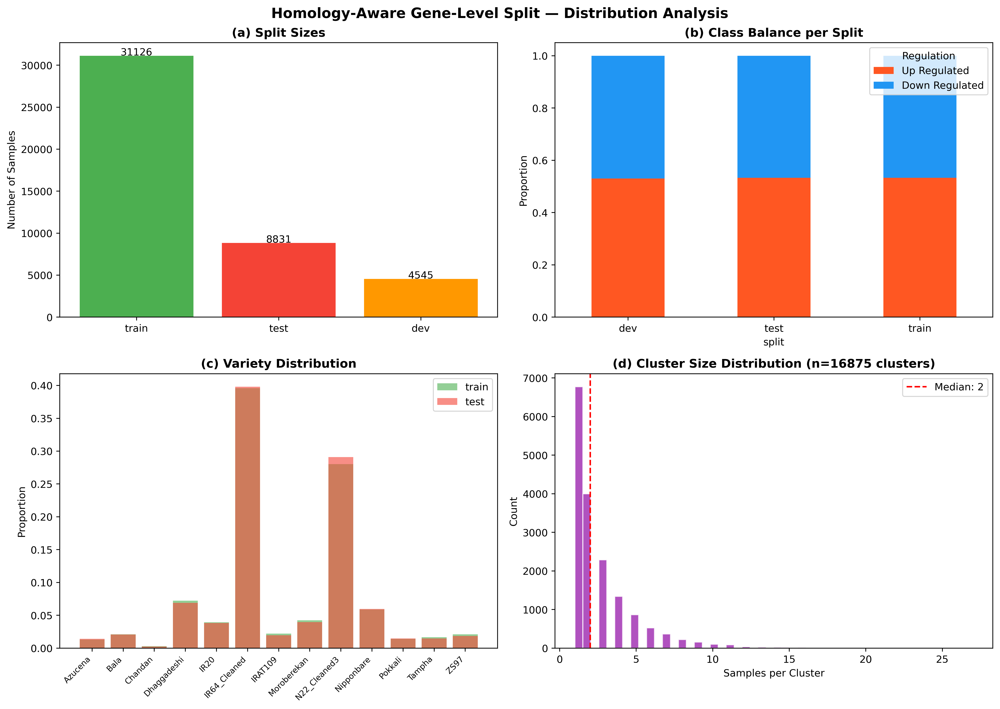
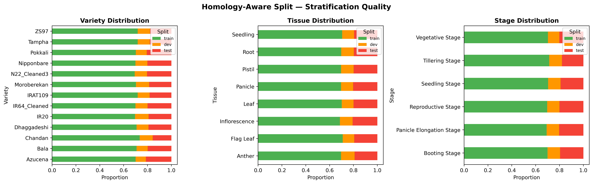
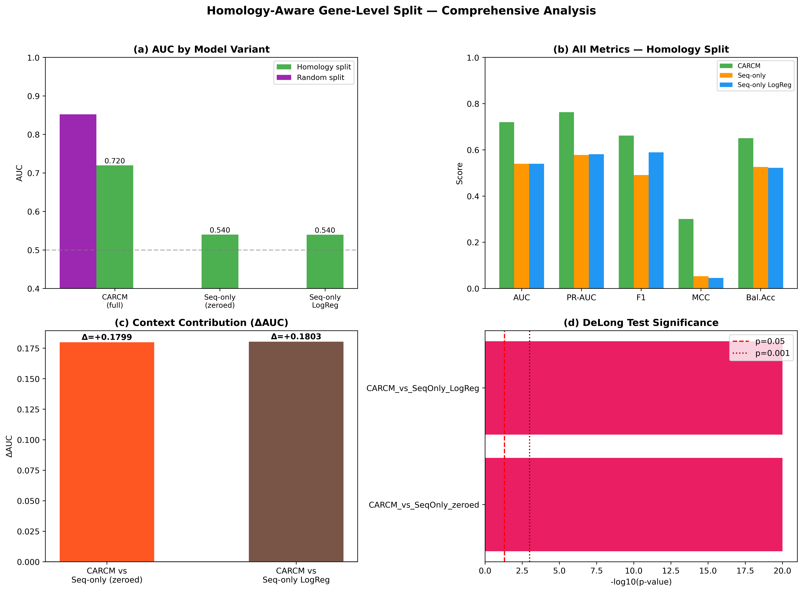
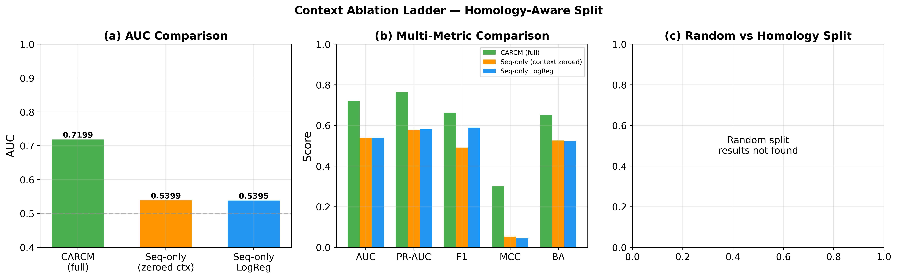

# Homology-Aware Gene-Level Split Analysis

## 1. Executive Summary

| Metric | Value | Interpretation |
|--------|-------|----------------|
| CARCM AUC (Homology) | 0.7199 | Robust performance on unseen gene families |
| Random Split AUC | 0.8522 | Previous evaluation with potential data leakage |
| ΔAUC (Random − Homology) | 0.1323 | Performance drop from sequence similarity |
| Context ΔAUC | +0.1799 | Context improvement persists under strict split |

## 2. Methods

### 2.1 Sequence Clustering

Promoter sequences (1000 bp) were clustered using CD-HIT-EST at 80% identity.

### 2.2 Cluster-Level Split

Entire clusters → train (70%)/dev (10%)/test (20%). No gene overlap between partitions.

### 2.3 Split Statistics

| split   |   n_samples |   n_genes |   n_clusters |   pct_up |   n_varieties |   n_tissues |   n_stages |
|:--------|------------:|----------:|-------------:|---------:|--------------:|------------:|-----------:|
| train   |       31126 |     11932 |        11821 |  53.338  |            13 |           8 |          6 |
| dev     |        4545 |      1711 |         1688 |  53.0033 |            13 |           8 |          6 |
| test    |        8831 |      3399 |         3366 |  53.2782 |            13 |           8 |          6 |

## 3. Results

### 3.1 Model Performance

| Model | AUC | PR-AUC | F1 | MCC | Balanced_Acc |
|---|---|---|---|---|---|
| CARCM (full) | 0.7199 | 0.7634 | 0.6616 | 0.3007 | 0.6507 |
| Seq-only (context zeroed) | 0.5399 | 0.5777 | 0.4912 | 0.0532 | 0.5262 |
| Seq-only LogReg | 0.5395 | 0.5813 | 0.5893 | 0.0455 | 0.5222 |

### 3.2 Statistical Significance

- CARCM vs SeqOnly zeroed: p = 0.000000 (**significant**)
- CARCM vs SeqOnly LogReg: p = 0.000000 (**significant**)

## 4. Conclusion

The homology-aware split yields CARCM AUC = **0.7199** (vs. 0.8522 random split, Δ = 0.1323). Context ablation ΔAUC = +0.1799 confirms that biological context provides genuine signal beyond sequence motifs even under the strictest evaluation.

## 5. Figures

